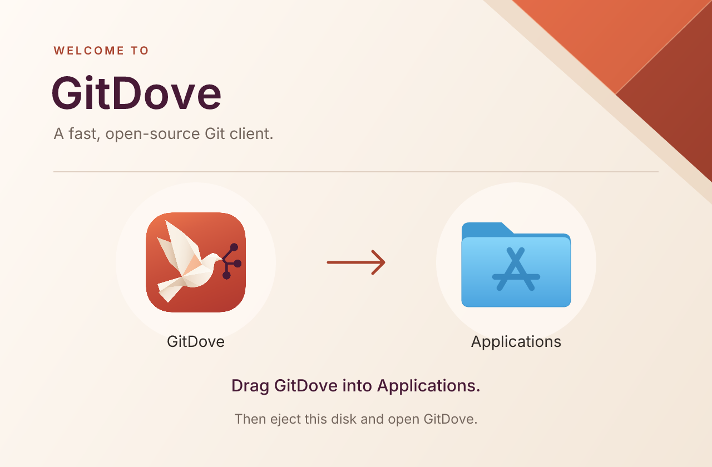

# macOS installer artwork

The DMG uses the Fold palette: parchment, the UI's `#a8432e` terracotta accent,
and the icon's `#471a36` plum. The folded corner echoes the dove's paper facets.
Finder supplies the real GitDove icon, Applications-folder link, and their labels;
none of these are baked into the background.



Layout preview with the committed app icon and an approximate Applications
folder; this is not a Finder screenshot.

## Artwork and layout

- `build/dmg-background.svg` is the editable vector source. Inter lettering is
  outlined, with the original strings, font weights, and sizes in comments, so
  rendering is independent of installed fonts. Keep edited lettering outlined.
- `build/dmg-background.png` is the 640 × 420 point canvas at 1×.
- `build/dmg-background@2x.png` is the same artwork at 1280 × 840 pixels.
  electron-builder 26 combines the pair into a multi-resolution TIFF on macOS.
- `electron-builder.yml` sets 112-point icons centered at `(176, 236)` and
  `(464, 236)`, with 14-point native labels below them. Coordinates are always
  at 1×. Keep the arrow, icon clearances, and canvas size aligned when editing.
- `dmg.icon` explicitly uses the static `build/icon.icns` for the mounted volume;
  the application still uses Icon Composer when available.

After editing the source, regenerate and commit both PNGs:

```sh
npm run dmg:background
npm run dmg:background -- --check
```

This uses the existing `@resvg/resvg-js` dependency and adds no packaging hook.
The check runs in CI to catch stale exports. In electron-builder 26.15.3 the
background's dimensions determine the window size; `dmg.window.width/height`
also document the intended canvas. Use the flat v26 window keys, not the nested
`window.size` form shown in some newer documentation.

## Inspect on macOS

```sh
npm ci
npm run dist -- --mac --arm64
open release/*/*.dmg
```

The existing CI packaging job also produces a DMG for pull requests that touch
these assets or the builder configuration. Download `packages-mac-arm64` from
the workflow run to inspect that exact build.

In Finder, check the following on both Retina and standard-resolution displays:

1. The entire 640 × 420 artwork is visible without scrollbars or clipping.
2. Both icons sit over the light circles, with native labels clear of the
   instruction. Check light and dark appearances and selected icons.
3. Dragging GitDove onto Applications copies the application. Eject the disk
   after copying, then open the copy from Applications.
4. Text and the arrow remain crisp at 2×. Do not double the icon coordinates.

A rendered background/layout preview on Linux is not a mounted Finder check;
the native folder artwork and Icon Composer rendering can vary with macOS.

## Other distributions

The macOS ZIP is Sparkle's update payload and has no installer window. Windows
uses one-click NSIS, so wizard header/sidebar artwork would not be shown in the
current flow; it already uses the Fold ICO. AppImage and deb also already use
the Fold icon set and have no shared installer canvas. Keep those formats and
installation flows as they are rather than adding unused artwork or a wizard.
